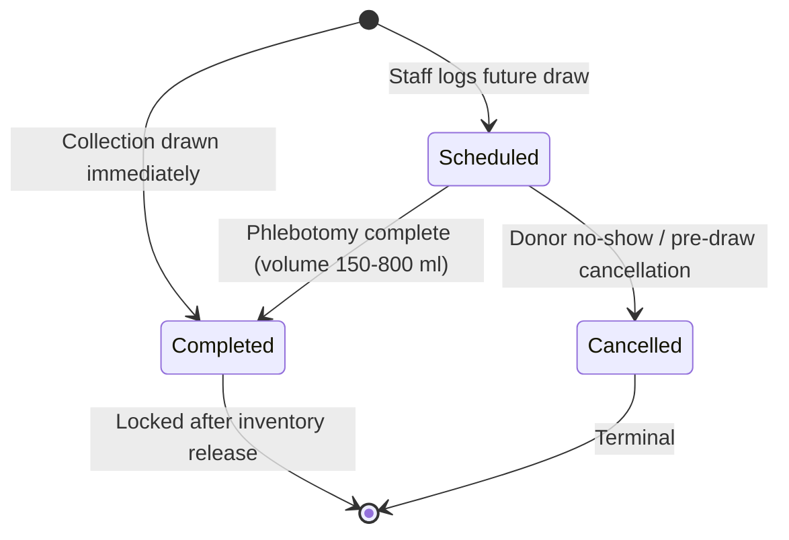
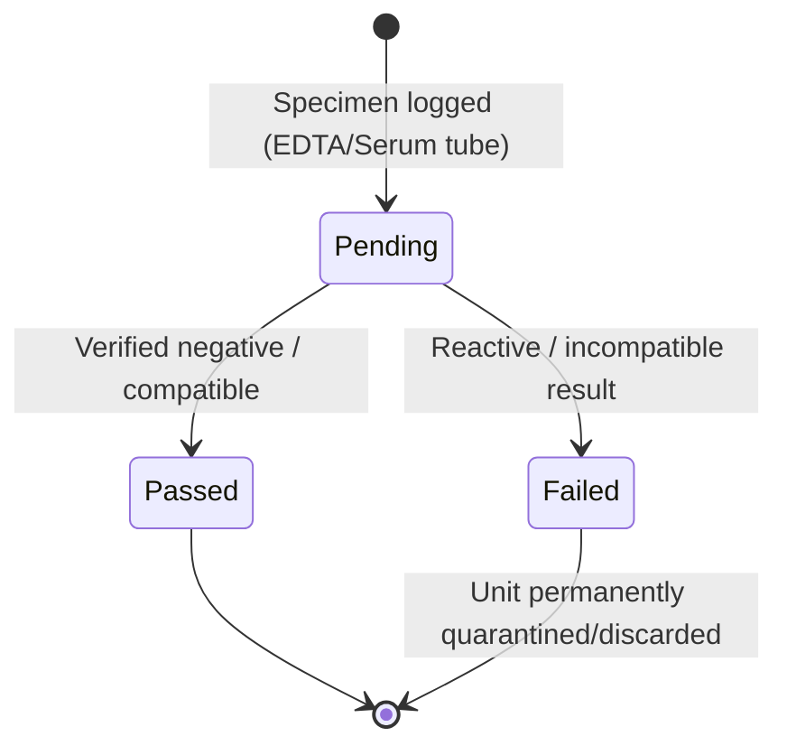
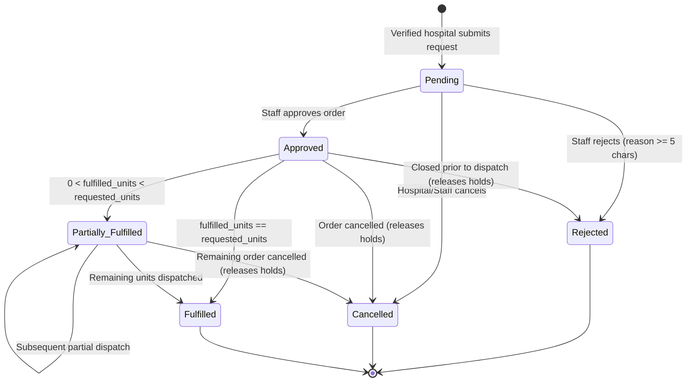
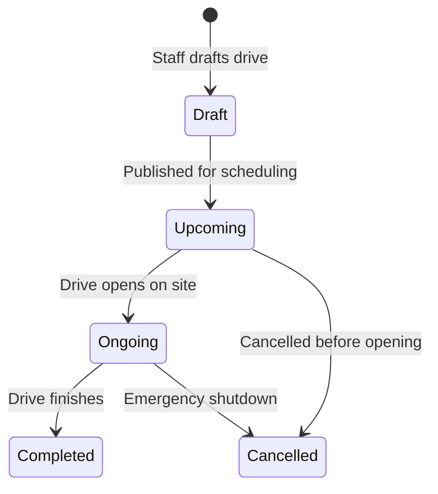
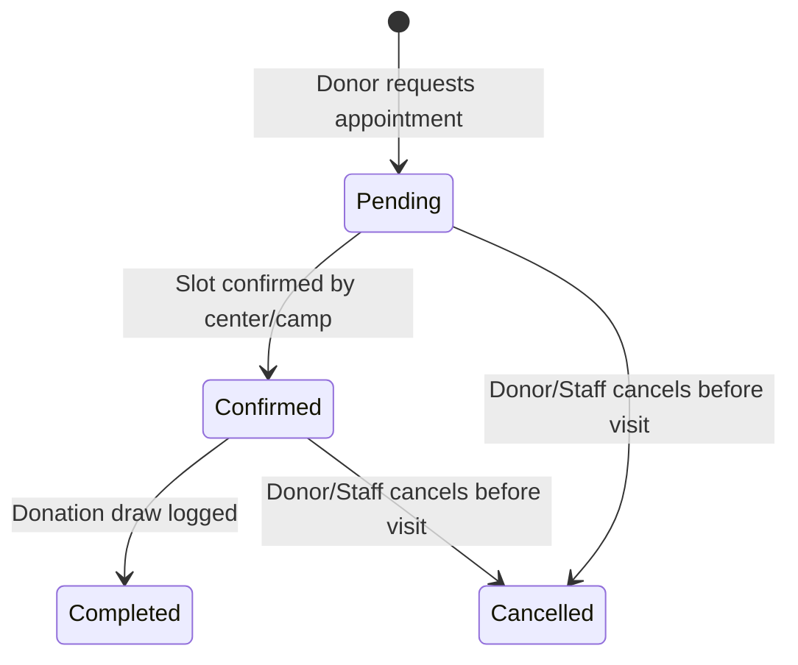

# BDMS Business Rules & Integrity Enforcement Architecture

This document defines the complete domain lifecycle rules and clearly classifies every rule into:
1. **Database Constraints** (always enforced at the storage engine layer)
2. **Backend Business Validation** (Laravel `FormRequest` & domain services)
3. **Database Transactions & Concurrency Locking** (`DB::transaction()` + pessimistic `SELECT ... FOR UPDATE`)

---

## 1. Enforcement Layer Matrix

| Domain Rule | Enforcement Layer | Exact Mechanism |
|---|---|---|
| Unique business codes (`DNR-1041`, `DON-4405`, `REQ-1044`, `CMP-308`, etc.) | **Database Constraint** | `UNIQUE` index on each `*_code` column |
| Valid ABO/Rh blood group (`A+`..`O-`) | **Database Constraint** + Validation | `ENUM('A+','A-','B+','B-','AB+','AB-','O+','O-')` + `Rule::in()` |
| Positive donation volume (`150`–`800` ml) | **Database Constraint** + Validation | `CHECK (quantity_ml BETWEEN 150 AND 800)` |
| Donor minimum age `>= 16` (`<= 110`) | **Backend Validation** | Derived from `donors.date_of_birth` vs `Carbon::today()` (MySQL forbids non-deterministic `CURDATE()` in `CHECK`) |
| Sensitive donor medical info separation | **Database Architecture** + Policy | `donor_medical_profiles` isolated via 1:1 FK; guarded by RBAC policy (`donors.view_medical`) |
| Donor profile completion before booking appointments | **Backend Validation** + Locking | Booking in `donor_appointments` requires `donors.profile_completed = 1` (all 8 fields complete: `full_name`, `email`, `phone`, `gender`, `date_of_birth`, `blood_group`, `address`, `emergency_contact`); Donor Portal browsing stays open; frontend warnings alone are insufficient |
| Donor eligibility single source of truth | **Database Constraint** + Service | `donor_eligibility_records.current_record_guard` `UNIQUE (donor_id, current_record_guard)` guarantees one `is_current = 1` row per donor; `donors.eligibility_status` and `next_eligible_date` are non-editable read-only projections synced in `DB::transaction()` |
| Donor verified eligibility before completed blood draw | **Backend Service Gate** + Schema | `donors.profile_completed = 1` and current verified `eligibility_status = 'Eligible'` (authoritative `donor_eligibility_records`) verified before transitioning `donations.collection_status` to `'Completed'` |
| No unscreened donation enters available stock | **Backend Transaction Gate** + Schema | `blood_units` start `'Quarantined'`; service releases to `'Available'` + `inventory_stocks` only when `collection_status = 'Completed'`, all active required panels in `component_screening_requirements` (`is_required = 1 AND is_active = 1` — seeded out of the box with all **5 tests**: `HIV`, `Hepatitis B`, `Hepatitis C`, `Syphilis`, `Blood Group Compatibility`) have `'Passed'` in `screening_records`, zero `'Pending'`/`'Failed'` records exist, and an authorized officer sets `approved_by_user_id` + `released_to_inventory_at` |
| Multi-component fractionation audit chain | **Database Architecture** + Transaction | `blood_units.parent_unit_id` self-FK (`ON DELETE SET NULL`) traces derived component bags back to parent collection bag |
| Non-negative stock & reserved quantities | **Database Constraint** + Locking | `INT UNSIGNED` + `CHECK (available_units >= 0 AND reserved_units >= 0)` |
| Single blood bag cannot be double-allocated | **Database Constraint** + Locking | `inventory_allocations.active_unit_guard` `UNIQUE (blood_unit_id, active_unit_guard)` + `FOR UPDATE` FIFO selection |
| Component-specific ABO/Rh compatibility & medical override accountability | **Database Constraint** + Policy + Service | `blood_compatibility_rules` `(recipient_blood_group, donor_blood_group, blood_component_id)` lookup + `request_fulfillments` `chk_fulfillment_override_audit` + RBAC permission `requests.override_compatibility` |
| Unverified hospitals cannot submit live blood orders | **Backend Policy** + Validation | `blood_requests` creation requires linked `hospitals.verification_status = 'Verified'` and `is_active = 1` |
| Requested units `>= 1`; fulfilled `<=` requested | **Database Constraint** + Validation | `CHECK (requested_units >= 1 AND fulfilled_units >= 0 AND fulfilled_units <= requested_units AND fulfilled_units + reserved_units <= requested_units)` |
| Lowering `requested_units` on edit cannot go below `fulfilled_units + reserved_units` | **Backend Validation** + Transaction | Validated under `FOR UPDATE` lock on `blood_requests` row |
| Rejected / Cancelled requests cannot be fulfilled | **Backend Service Lock** + Validation | Transaction reads locked `blood_requests.status`; throws domain exception if in `['Rejected', 'Cancelled', 'Fulfilled']` |
| Concurrent request fulfillment never over-allocates stock | **DB Transaction + Locking** | Lock `blood_requests` row -> Lock `inventory_stocks` row `FOR UPDATE` -> Lock FIFO `blood_units` rows `FOR UPDATE` |
| Only one active registration per donor per camp while preserving cancelled history | **Database Constraint** | Generated column `active_registration_guard` + `UNIQUE (camp_id, donor_id, active_registration_guard)` on `camp_registrations` |
| Camp capacity (`active_registrations <= capacity`) | **DB Transaction + Locking** | Lock `donation_camps` row `FOR UPDATE`, count `attendance_status <> 'Cancelled'`, verify `< capacity` before insert |
| Camp dates (`end_date >= start_date`, `end_time > start_time`, `deadline <= start_date`) | **Database Constraint** + Validation | Table `CHECK` constraints on `donation_camps` + FormRequest rules |
| Appointment must target either a Center OR a Camp (never both/neither) | **Database Constraint** | `chk_appointment_single_target` `CHECK ((donation_center_id IS NOT NULL AND donation_camp_id IS NULL) OR (donation_center_id IS NULL AND donation_camp_id IS NOT NULL))` |
| Donor cannot hold duplicate active appointments for the same `(date, time)` | **Database Constraint** | Non-null `slot_time` + generated column `active_slot_guard` + `UNIQUE (donor_id, appointment_date, slot_time, active_slot_guard)` |
| Time-slot capacity (e.g., max 3 per fixed center slot) | **DB Transaction + Locking** | Lock parent `donation_centers` row `FOR UPDATE`, count non-cancelled appointments for `(donation_center_id, appointment_date, slot_time)` `< default_slot_capacity` |
| Immutable transaction & status timelines | **Database Architecture** | Append-only tables (`inventory_transactions`, `*_status_histories`) without update/delete endpoints (`ON DELETE RESTRICT`) |

---

## 2. Core Lifecycle Rules & Workflows

### 2.1 Donation Lifecycle

- **Rules**:
  1. A donation requires a valid `donor_id`, explicit `blood_component_id`, `donation_date`, `quantity_ml` (`150`–`800`), `collection_status`, `screening_status`, and `staff_member_name`.
  2. Before a donation can transition to `collection_status = 'Completed'`, backend intake validation checks `donors.profile_completed = 1` (confirming all 8 required fields: `full_name`, `email`, `phone`, `gender`, `date_of_birth`, `blood_group`, `address`, and `emergency_contact`) and verifies current `'Eligible'` clearance from the authoritative `donor_eligibility_records` (`is_current = 1`) / synchronized `donors.eligibility_status`.
  3. Recording a `Completed` donation **never** directly increments `inventory_stocks.available_units`. Newly collected bags enter `blood_units` with `unit_status = 'Quarantined'` (`parent_unit_id = NULL` under the standard `1 donation -> 1 unit` flow).
  4. When component splitting is enabled by a facility, a cleared or quarantined primary unit may be fractionated inside an atomic transaction into derived `blood_units` rows pointing to `parent_unit_id` (e.g., `1 Whole Blood` yielding derived `Packed RBC`, `Plasma`, and `Platelets` bags).
  5. When a donation is recorded as `Completed`, backend post-processing updates `donors.last_donation_date` and increments `donors.total_completed_donations`.

### 2.2 Lab Screening & Inventory Release Lifecycle

- **Rules**:
  1. One `donations` row may have multiple `screening_records` across `screening_test_types`. BDMS currently uses **five standard assays**: `HIV`, `Hepatitis B`, `Hepatitis C`, `Syphilis`, and `Blood Group Compatibility`.
  2. Screening results must be **explicitly entered** (`Pending`, `Passed`, `Failed`) by authorized lab personnel (`performed_by_user_id`); `collection_status = 'Completed'` never implies `screening_status = 'Passed'`.
  3. **Five-Panel Baseline & Extensible Component Release Gate**:
     - Initial database seeders populate `component_screening_requirements` with `is_required = 1, is_active = 1` for **all 5 standard assays (`HIV`, `Hepatitis B`, `Hepatitis C`, `Syphilis`, `Blood Group Compatibility`) across every blood component**. This five-panel baseline is active immediately without waiting for future clinical approvals, while `component_screening_requirements` stays extensible for future medically approved component-specific policies.
     - Inside an atomic `DB::transaction()`:
       - Lock target `donations` row (`FOR UPDATE`) and verify `collection_status = 'Completed'` and `released_to_inventory_at IS NULL`.
       - Verify **zero** `screening_records` on that donation have `screening_result IN ('Failed', 'Pending')`.
       - Query `component_screening_requirements` where `blood_component_id = donations.blood_component_id AND is_required = 1 AND is_active = 1` and verify **every** required `test_type_id` (all 5 tests in the baseline workflow) has a `'Passed'` record in `screening_records` on that donation.
       - Require explicit authorization from an officer holding `screening.release_inventory`: set `donations.screening_status = 'Passed'`, `released_to_inventory_at = NOW()`, `approved_by_user_id`.
       - Lock corresponding `inventory_stocks` row `(blood_group, blood_component_id) FOR UPDATE`.
       - Transition associated `blood_units` (`Quarantined` -> `'Available'`, set `released_at`, `released_by_user_id`, and `expires_at = collected_at + INTERVAL shelf_life_days DAY`).
       - Increment `inventory_stocks.available_units += N` and append `'Stock In'` entry to `inventory_transactions`.
  4. If any screening record is marked `'Failed'`, set `donations.screening_status = 'Failed'`, mark linked `blood_units` as `'Discarded'`, append a zero-delta `'Discarded'` audit event in `inventory_transactions` (`units_delta = 0`, `available_after = available_before`, `reserved_after = reserved_before`, since quarantined units are not yet released to `inventory_stocks`), and record an automated protective `'Not Eligible'` deferral via `DonorEligibilityService` (`reviewed_by_user_id = NULL`, `reviewed_at = NULL`, `next_eligible_date = NULL`, inserting a new `is_current = 1` row in `donor_eligibility_records` and syncing `donors.eligibility_status`) pending authorizing medical officer review.

### 2.3 Inventory Management & Stock Status Lifecycle

- **Component Tracking + 8-Group Rollups**:
  - `inventory_stocks` persists balances per `(blood_group, blood_component_id)`.
  - Summary views (`InventoryController`, `PublicPortalController`, Dashboard KPIs) compute 8-group stock totals cleanly via SQL `SUM(available_units) ... GROUP BY blood_group` (or filter by `blood_component_id` when component-level inventory cards are active).
- **Status Evaluation**: Always computed from `inventory_stocks` rather than stored as a mutable column:
  - `critical` if `available_units <= floor(minimum_level * 0.6)`
  - `low` if `available_units <= minimum_level`
  - `normal` otherwise
- **Atomic Adjustment Rules**:
  1. Every stock mutation locks the target `inventory_stocks` row (`SELECT ... FOR UPDATE`).
  2. `'Stock In'` / positive adjustment increments `available_units` (`units_delta > 0`).
  3. `'Removed'` / `'Expired'` / `'Discarded'` decrements `available_units` (`units <= available_units`) and marks corresponding serialized `blood_units` (`Dispatched` / `Expired` / `Discarded`); discarding a pre-release `'Quarantined'` unit during failed screening logs `'Discarded'` with `units_delta = 0` and unchanged stock balances.
  4. `'Reserved'` transfers units from `available_units` to `reserved_units` (`units <= available_units`) — total physical stock (`available + reserved`) stays unchanged while usable unallocated stock drops by `units`.
  5. Every adjustment writes a paired immutable `inventory_transactions` row storing `available_before`, `available_after`, `reserved_before`, `reserved_after`, and a mandatory justification `description` (`>= 3` chars).

### 2.4 Blood Request, Compatibility & Fulfillment Lifecycle

- **Hospital Verification Gate**: Self-registered hospital accounts (`hospitals.verification_status = 'Pending'`) can inspect their facility status in the portal but are blocked by policy/FormRequest from submitting live `blood_requests` until an administrator verifies facility credentials (`verification_status = 'Verified'` and `is_active = 1`).
- **Component Resolution**: `blood_requests.blood_component_id` may be specified at order time or `NULL` for legacy/general blood-group orders; at dispatch, staff select the exact `blood_component_id` of units being released, and `request_fulfillments.blood_component_id` (`NOT NULL`) records the exact shipped component.

#### Atomic Compatibility Check, Reservation & Fulfillment Sequence (Concurrency-Safe Blueprint)

When staff record a partial or full dispatch (`dispatchUnits = K`, `dispatched_blood_group`, `blood_component_id`, `dispatch_date`) inside `DB::transaction()`:

1. **Lock Request**: `SELECT * FROM blood_requests WHERE id = ? FOR UPDATE`.
   - Abort if `status IN ('Rejected', 'Cancelled', 'Fulfilled')`.
   - Assert `K >= 1` integer and `fulfilled_units + K <= requested_units`.
2. **Validate Clinical Compatibility (`blood_compatibility_rules`)**:
   - Look up `blood_compatibility_rules` for `(recipient_blood_group = blood_requests.blood_group, donor_blood_group = dispatched_blood_group, blood_component_id = dispatch_component_id, is_active = 1)`.
   - If no active compatible rule exists, **abort entire transaction (HTTP 422)**.
   - If `compatibility_level = 'Emergency Only'` or `requires_medical_override = 1`:
     - Verify actor holds RBAC permission `requests.override_compatibility` (or approved clinical officer co-sign).
     - Require non-empty `override_reason`, set `is_compatibility_override = 1`, `override_approved_by_user_id`, and `override_approved_at = NOW()` (additionally enforced at DB storage level by `chk_fulfillment_override_audit`).
3. **Lock Inventory Bucket**: `SELECT * FROM inventory_stocks WHERE blood_group = dispatched_blood_group AND blood_component_id = dispatch_component_id FOR UPDATE`.
4. **Consume Reserved Holds First, Then Unreserved Available Units (FIFO)**:
   - Fetch existing `inventory_allocations` for this request matching `(dispatched_blood_group, blood_component_id)` where `allocation_status = 'Reserved'` (FIFO by `expires_at ASC` via joined `blood_units`) `FOR UPDATE` up to `K` units (`R` units found).
   - Remaining needed `U = K - R`.
   - If `U > 0`, assert `inventory_stocks.available_units >= U` and lock `U` rows from `blood_units` where `blood_group = dispatched_blood_group AND blood_component_id = dispatch_component_id AND unit_status = 'Available' AND expires_at > NOW() ORDER BY expires_at ASC LIMIT U FOR UPDATE`. (Abort entire transaction with 422 if fewer than `U` non-expired eligible units exist.)
5. **Create Dispatch Record & Mutate States Atomically**:
   - Insert `request_fulfillments` (`FUL-xxxx`, `units_dispatched = K`, `dispatched_blood_group`, `blood_component_id`, `dispatch_date`, `delivery_status = 'Dispatched'`, plus override audit columns when triggered).
   - Update consumed `R` allocations (`allocation_status = 'Dispatched'`, `fulfillment_id`, `dispatched_at = NOW()`) and insert `U` new `inventory_allocations` (`Dispatched`, `fulfillment_id`).
   - Update all `K` `blood_units` to `unit_status = 'Dispatched'`.
   - Update `inventory_stocks`: `reserved_units -= R`, `available_units -= U`, `last_adjusted_at = NOW()`.
   - Append `inventory_transactions` (`operation_type = 'Dispatch'`, `units_delta = -K`, exact before/after balances, `reference_type = 'fulfillment'`).
   - Update `blood_requests`: `reserved_units -= R`, `fulfilled_units += K`, and resolve `status = (fulfilled_units === requested_units) ? 'Fulfilled' : 'Partially Fulfilled'`.
   - Append `blood_request_status_histories` event.

- **Cancellation / Rejection Cleanup**:
  - When transitioning to `Rejected` or `Cancelled`, lock and release any `Reserved` `inventory_allocations` (`allocation_status = 'Released'`, `released_at = NOW()`), transition held `blood_units` back from `Reserved` -> `Available`, move `inventory_stocks` `reserved_units -> available_units`, zero out `blood_requests.reserved_units`, and log `'Release Reservation'` in `inventory_transactions`.

### 2.5 Donation Camp & Registration Lifecycle

- **Capacity, Cancellation & Re-Registration Rules**:
  1. Active registrations = `COUNT(*) FROM camp_registrations WHERE camp_id = ? AND attendance_status <> 'Cancelled'`.
  2. Public Portal strictly displays `status IN ('Upcoming', 'Ongoing')` ONLY and withholds `camp_registrations` rosters and staff organizer PII.
  3. Primary capacity gate on mobile drives is total active event registrations `< donation_camps.capacity`.
  4. Creating a registration locks `donation_camps` (`FOR UPDATE`), checks `status IN ('Upcoming', 'Ongoing')`, verifies `active_registrations < capacity`, checks `allow_walk_in = 1` when `Ongoing`, and checks `today <= registration_deadline` when `Upcoming`.
  5. **Preserving Cancelled History While Allowing Re-Registration**: `camp_registrations` pairs generated column `active_registration_guard` (`CASE WHEN attendance_status <> 'Cancelled' THEN 1 ELSE NULL END`) with `UNIQUE (camp_id, donor_id, active_registration_guard)`. When a registration is cancelled (`attendance_status = 'Cancelled'`, `cancelled_at = NOW()`), the row stays intact for attendance analytics (`REG-805`) while setting `active_registration_guard = NULL`, enabling the donor to re-register via a fresh registration row (`REG-806`) as long as camp capacity permits.
  6. Unifying existing JS & controller checks: Frontend `camps.js` staff walk-in/registration checks will ignore `'Cancelled'` rows when blocking duplicates—matching `DonorPortalController::buildDonorCamps()`.

### 2.6 Donor Appointment Lifecycle

- **Rules**:
  1. **Backend Profile Completion Gate (`profile_completed = 1`)**: Before inserting a `donor_appointments` record (self-service Donor Portal or Staff scheduling), `FormRequest` validation and the transactional booking service (`SELECT * FROM donors WHERE id = ? FOR UPDATE`) must verify `donors.profile_completed = 1` and that all **8 required profile fields** (`full_name`, `email`, `phone`, `gender`, `date_of_birth`, `blood_group`, `address`, `emergency_contact`) are non-empty. Incomplete accounts (`profile_completed = 0`) must receive HTTP 422 / validation error; UI banners alone are insufficient.
  2. XOR target enforced in DB (`chk_appointment_single_target`): appointment references either `donation_center_id` or `donation_camp_id`.
  3. Minimum date: `appointment_date >= today` (for camps, also within `[start_date, end_date]`).
  4. Slot concurrency check:
     - For **fixed centers**: lock parent `donation_centers` row `FOR UPDATE`, count non-cancelled appointments matching `(donation_center_id, appointment_date, slot_time)` `< default_slot_capacity` (`3`).
     - For **donation camps**: lock parent `donation_camps` row `FOR UPDATE`, enforce primary total drive limit `active_registrations < donation_camps.capacity` (with time-window advisory display derived from `start_time`–`end_time`).
  5. Duplicate active donor slot protection: `slot_time` is strictly `NOT NULL` across both center and camp bookings so generated column `active_slot_guard` + `UNIQUE (donor_id, appointment_date, slot_time, active_slot_guard)` cannot be bypassed by `NULL != NULL` uniqueness behavior in MySQL, while permitting rebooking after `'Cancelled'`.
  6. Linking camp bookings: A camp-targeted appointment synchronizes atomically with an active `camp_registrations` row (`appointment_id`); cancelling the appointment cancels the linked camp registration (`attendance_status = 'Cancelled'`, `cancelled_at = NOW()`), freeing camp capacity.

### 2.7 Donor Eligibility Source of Truth, Profile Completion & Privacy Rules

1. **Authoritative Source of Truth vs. Read-Only Synchronized Cache**:
   - **`donor_eligibility_records` is the authoritative single source of truth** for donor eligibility (`'Eligible'`, `'Not Eligible'`, `'Pending Review'`, `'Unknown'`), reason text, `clearance_source`, `reviewed_at`, `next_eligible_date`, and `reviewed_by_user_id`.
   - **`donor_eligibility_records.current_record_guard`** (`UNIQUE (donor_id, current_record_guard)`) guarantees at most one active (`is_current = 1`) row per donor while preserving all prior decisions (`is_current = 0`) as immutable audit history.
   - **`donors.eligibility_status` and `donors.next_eligible_date` are read-only synchronized projections** maintained solely for directory filtering and KPI counts. Generic donor CRUD controllers, Donor Portal profile updates, and Eloquent `$fillable` mass assignment **never** allow independent edits to `donors.eligibility_status` or `donors.next_eligible_date`.
2. **Synchronization & Update Protocol (`DonorEligibilityService`)**:
   - **Initial Donor Onboarding**: Creating any `donors` row (whether via public `/register` starting `'Pending Review'` or staff intake) inserts its initial `is_current = 1` row in `donor_eligibility_records` and sets `donors.eligibility_status` + `donors.next_eligible_date` atomically inside the same `DB::transaction()`.
   - **Status Transitions & Automated Deferrals**: Every manual clinical review, post-donation deferral, or `'Failed'` lab screening deferral locks `donors` (`FOR UPDATE`), sets existing `is_current = 1` rows in `donor_eligibility_records` to `is_current = 0` (`current_record_guard -> NULL`), inserts the new `is_current = 1` `donor_eligibility_records` row, and copies its `eligibility_status` and `next_eligible_date` onto `donors` before committing.
3. **Required Donor Profile Fields (`profile_completed = 1`) & Access Tiers**:
   - **Exact Required Fields**: `full_name`, `email`, `phone`, `gender`, `date_of_birth` (age `16`–`110`), `blood_group`, `address`, and `emergency_contact`. Backend save logic sets `profile_completed = 1` when and only when all 8 fields are populated and valid; public `/register` starts with `profile_completed = 0` when optional profile fields are omitted.
   - **Donor Portal Read Access**: Authenticated donors with `profile_completed = 0` retain access to browse Donor Portal pages (`/donor-portal`, donation history, eligibility status, appointment schedule view) with profile-completion prompts.
   - **Appointment Booking Gate**: Backend validation strictly blocks creating `donor_appointments` when `profile_completed = 0` (frontend warnings alone are insufficient).
   - **Physical Donation Gate**: Transitioning `donations.collection_status` to `'Completed'` requires **both** `profile_completed = 1` **and** current verified `'Eligible'` clearance in `donor_eligibility_records` (`is_current = 1`) / synchronized `donors.eligibility_status`.
4. Public APIs/pages **never** expose donor names, `donor_code`, medical notes, or screening records.
5. Donor Portal queries mask contact info (`el***@example.org`, `+1 (***) ***-8812`) where required and exclude staff-only clinical notes (`donor_medical_profiles`, `donations.collection_notes`, `donations.staff_member_name`, `screening_records.specimen_tube_code`).

---

## 3. MySQL 8.4.3 & SQLite `:memory:` Migration Engineering Rules

Because production runs **MySQL `8.4.3`** (`InnoDB`) while PHPUnit runs **SQLite `:memory:`** (`phpunit.xml`), migrations must obey these engine-compatibility rules:

1. **Declare `STORED` generated columns and `CHECK` constraints inside `Schema::create(...)` ONLY**: SQLite forbids adding `GENERATED ALWAYS AS (...) STORED` columns or table `CHECK` constraints via `ALTER TABLE` (`Schema::table(...)`), whereas both MySQL `8.4.3` and SQLite `3.40+` execute Laravel 13 `Blueprint` `->storedAs(...)`, `->unique(...)`, and `->check(...)` identically when declared inside `Schema::create(...)`.
2. **Avoid non-deterministic functions in `CHECK` / generated columns**: Never reference `CURDATE()` or `NOW()` in DDL constraints.
3. **Avoid raw vendor-specific `ENUM` ALTER statements after table creation**: Keep canonical status lists accurate inside initial `Schema::create(...)` migrations.
4. **Always enforce signedness parity on foreign keys**: Use `foreignId(...)` / `unsignedBigInteger(...)` (`BIGINT UNSIGNED`) consistently so InnoDB FK creation never fails with `errno 150`.
