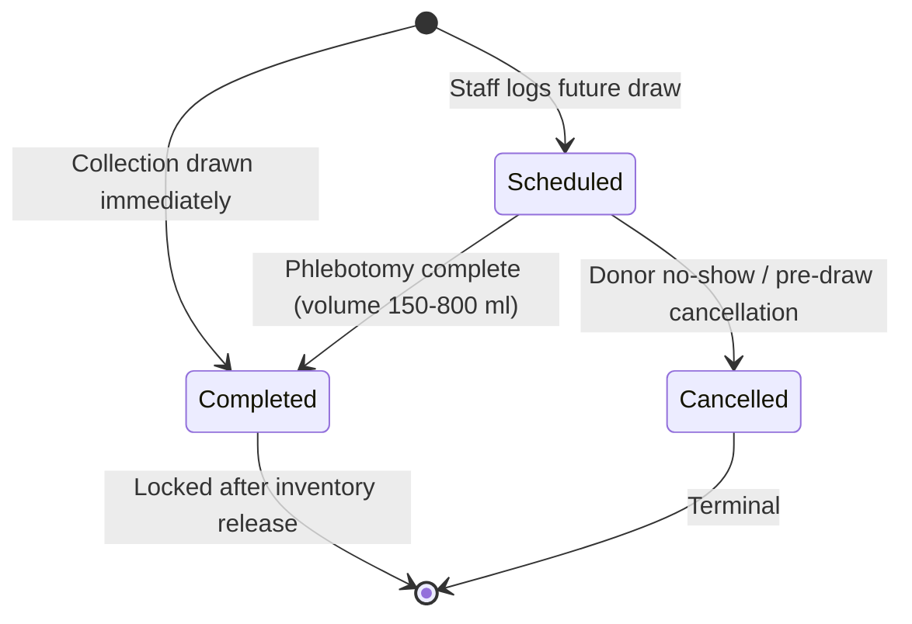
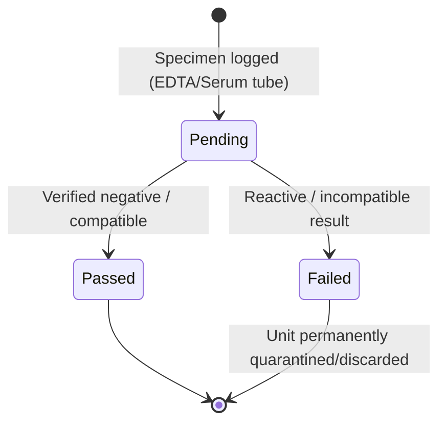
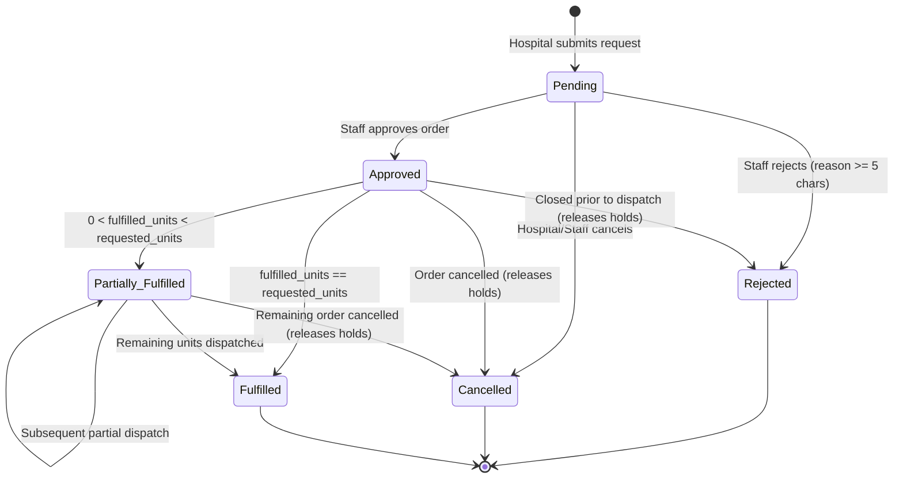
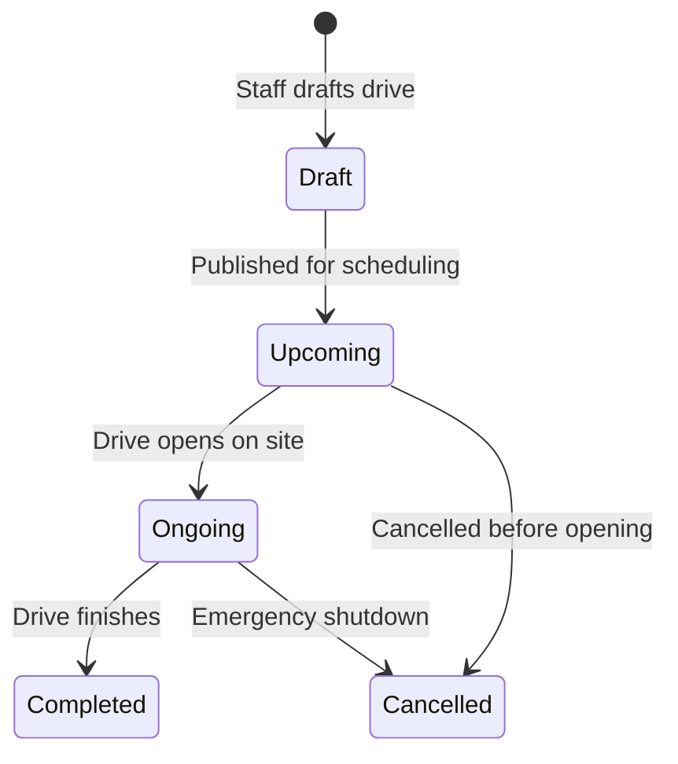
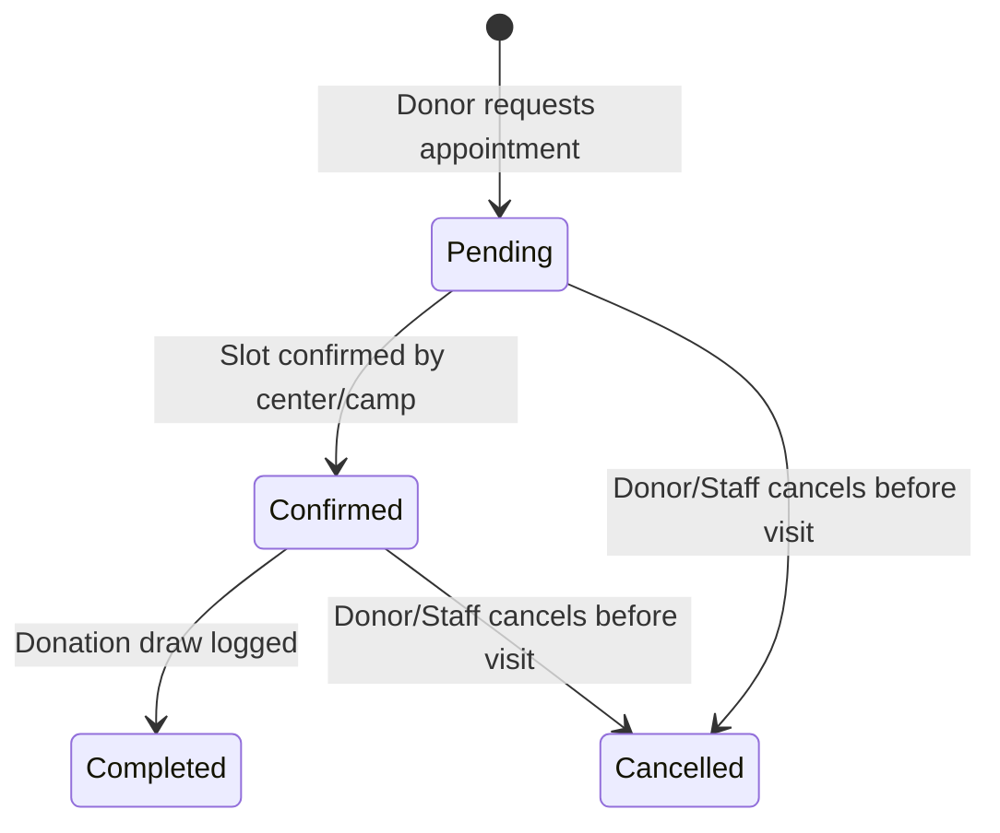

# BDMS Business Rules & Integrity Enforcement Architecture

This document defines the complete domain lifecycle rules and clearly classifies every rule into:
1. **Database Constraints** (always enforced at the MySQL storage layer)
2. **Backend Business Validation** (Laravel `FormRequest` & domain services)
3. **Database Transactions & Concurrency Locking** (`DB::transaction()` + pessimistic `SELECT ... FOR UPDATE`)

---

## 1. Enforcement Layer Matrix

| Domain Rule | Enforcement Layer | Exact Mechanism |
|---|---|---|
| Unique business codes (`DNR-1041`, `DON-4405`, `REQ-1044`, `CMP-308`, etc.) | **Database Constraint** | `UNIQUE` index on each `*_code` column |
| Valid ABO/Rh blood group (`A+`..`O-`) | **Database Constraint** + Validation | `ENUM('A+','A-','B+','B-','AB+','AB-','O+','O-')` + `Rule::in()` |
| Positive donation volume (`150`–`800` ml) | **Database Constraint** + Validation | `CHECK (quantity_ml BETWEEN 150 AND 800)` |
| Donor minimum age `>= 16` (`<= 110`) | **Backend Validation** | Derived from `donors.date_of_birth` vs `Carbon::today()` (MySQL forbids non-deterministic `CURDATE()` in `CHECK`) |
| Sensitive donor medical info separation | **Database Architecture** + Policy | `donor_medical_profiles` isolated via 1:1 FK; guarded by RBAC policy (`donors.view_medical`) |
| No unscreened donation enters available stock | **Backend Transaction Gate** + Schema | `blood_units` start `'Quarantined'`; service releases to `'Available'` + `inventory_stocks` only when `collection_status = 'Completed'`, all mandatory panels in `screening_records` are `'Passed'`, zero `'Failed'`/`'Pending'`, and medical officer sets `approved_by_user_id` + `released_to_inventory_at` |
| Non-negative stock & reserved quantities | **Database Constraint** + Locking | `INT UNSIGNED` + `CHECK (available_units >= 0 AND reserved_units >= 0)` |
| Single blood bag cannot be double-allocated | **Database Constraint** + Locking | `inventory_allocations.active_unit_guard` `UNIQUE (blood_unit_id, active_unit_guard)` + `FOR UPDATE` FIFO selection |
| Requested units `>= 1`; fulfilled `<=` requested | **Database Constraint** + Validation | `CHECK (requested_units >= 1 AND fulfilled_units >= 0 AND fulfilled_units <= requested_units AND fulfilled_units + reserved_units <= requested_units)` |
| Lowering `requested_units` on edit cannot go below `fulfilled_units + reserved_units` | **Backend Validation** + Transaction | Validated under lock on `blood_requests` row |
| Rejected / Cancelled requests cannot be fulfilled | **Backend Service Lock** + Validation | Transaction reads locked `blood_requests.status`; throws domain exception if in `['Rejected', 'Cancelled', 'Fulfilled']` |
| Concurrent request fulfillment never over-allocates stock | **DB Transaction + Locking** | Lock `blood_requests` row -> Lock `inventory_stocks` row `FOR UPDATE` -> Lock FIFO `blood_units` rows `FOR UPDATE` |
| Donor cannot register twice for the same camp | **Database Constraint** | `UNIQUE (camp_id, donor_id)` on `camp_registrations` |
| Camp capacity (`active_registrations <= capacity`) | **DB Transaction + Locking** | Lock `donation_camps` row `FOR UPDATE`, count `attendance_status <> 'Cancelled'`, verify `< capacity` before insert/reactivation |
| Camp dates (`end_date >= start_date`, `end_time > start_time`, `deadline <= start_date`) | **Database Constraint** + Validation | Table `CHECK` constraints on `donation_camps` + FormRequest rules |
| Appointment must target either a Center OR a Camp (never both/neither) | **Database Constraint** | `CHECK ((donation_center_id IS NOT NULL AND donation_camp_id IS NULL) OR (donation_center_id IS NULL AND donation_camp_id IS NOT NULL))` |
| Donor cannot hold duplicate active appointments for the same `(date, time)` | **Database Constraint** | Generated column `active_slot_guard` + `UNIQUE (donor_id, appointment_date, slot_time, active_slot_guard)` |
| Time-slot capacity (e.g., max 3 per center slot) | **DB Transaction + Locking** | Lock parent `donation_centers` row `FOR UPDATE`, count active appointments for `(donation_center_id, appointment_date, slot_time)` `< default_slot_capacity` |
| Immutable transaction & status timelines | **Database Architecture** | Append-only tables (`inventory_transactions`, `*_status_histories`) without update/delete endpoints (`ON DELETE RESTRICT`) |

---

## 2. Core Lifecycle Rules & Workflows

### 2.1 Donation Lifecycle

- **Rules**:
  1. A donation requires a valid `donor_id` and explicit `blood_component_id`, `donation_date`, `quantity_ml` (`150`–`800`), `collection_status`, `screening_status`, and `staff_member_name`.
  2. `blood_group` is inherited and verified from the donor record at collection (`donors.blood_group` cannot remain unset once a donation occurs).
  3. Recording a `Completed` donation **never** directly increments `inventory_stocks.available_units`. Newly collected bags enter `blood_units` with `unit_status = 'Quarantined'` until lab screening passes and inventory release is approved.
  4. When a donation is recorded as `Completed`, backend post-processing updates `donors.last_donation_date` and `donors.total_completed_donations`.

### 2.2 Lab Screening & Inventory Release Lifecycle

- **Rules**:
  1. One `donations` row may have multiple `screening_records` across `screening_test_types` (`HIV`, `Hepatitis B`, `Hepatitis C`, `Syphilis`, `Blood Group Compatibility`).
  2. Screening results must be **explicitly entered** (`Pending`, `Passed`, `Failed`) by authorized lab personnel (`performed_by_user_id`); `collection_status = 'Completed'` never implies `screening_status = 'Passed'`.
  3. **Release Gate to Available Inventory**: Inside an atomic `DB::transaction()`:
     - Verify `donations.collection_status = 'Completed'` and `donations.released_to_inventory_at IS NULL`.
     - Verify **zero** `screening_records` on that donation have `screening_result = 'Failed'` or `'Pending'`.
     - Verify all mandatory test types (`screening_test_types.is_mandatory_for_release = 1`) have a `'Passed'` result (`is_confirmatory = 0` or cleared confirmatory override).
     - Set `donations.screening_status = 'Passed'`, `released_to_inventory_at = NOW()`, `approved_by_user_id`.
     - Lock `inventory_stocks` row `(blood_group, blood_component_id) FOR UPDATE`.
     - Transition associated `blood_units` (`Quarantined` → `'Available'`, set `released_at`, `expires_at = collected_at + INTERVAL shelf_life_days DAY`).
     - Increment `inventory_stocks.available_units += N` and append `'Stock In'` entry to `inventory_transactions`.
  4. If any screening record is marked `'Failed'`, set `donations.screening_status = 'Failed'`, mark linked `blood_units` `'Discarded'`, append `'Discarded'` transaction audit (`units_delta` logged or quarantine disposition event), and trigger clinician follow-up in `donor_eligibility_records` (`Not Eligible`).

### 2.3 Inventory Management & Stock Status Lifecycle

- **Status Evaluation**: Always computed from `inventory_stocks`:
  - `critical` if `available_units <= floor(minimum_level * 0.6)`
  - `low` if `available_units <= minimum_level`
  - `normal` otherwise
- **Atomic Adjustment Rules**:
  1. Every stock mutation locks the target `inventory_stocks` row (`SELECT ... FOR UPDATE`).
  2. `'Added'` / `'Stock In'` increments `available_units` (`units > 0`) and records positive `units_delta`.
  3. `'Removed'` / `'Expired'` / `'Discarded'` decrements `available_units` (`units <= available_units`) and marks corresponding `blood_units` (`Dispatched` / `Expired` / `Discarded`).
  4. `'Reserved'` transfers units from `available_units` to `reserved_units` (`units <= available_units`) — total physical stock (`available + reserved`) stays unchanged while usable unallocated stock drops by `units`.
  5. Every adjustment writes a paired immutable `inventory_transactions` row storing `available_before`, `available_after`, `reserved_before`, `reserved_after`, and a mandatory justification `description` (`>= 3` chars).

### 2.4 Blood Request & Fulfillment Lifecycle

#### Atomic Reservation & Fulfillment Sequence (Concurrency-Safe Blueprint)

When staff record a partial or full dispatch (`dispatchUnits = K`, `blood_group`, `blood_component_id`, `dispatch_date`) inside `DB::transaction()`:

1. **Lock Request**: `SELECT * FROM blood_requests WHERE id = ? FOR UPDATE`.
   - Abort if `status IN ('Rejected', 'Cancelled', 'Fulfilled')`.
   - Assert `K >= 1` integer and `fulfilled_units + K <= requested_units`.
2. **Lock Inventory Bucket**: `SELECT * FROM inventory_stocks WHERE blood_group = ? AND blood_component_id = ? FOR UPDATE`.
3. **Consume Reserved Holds First, Then Unreserved Available Units (FIFO)**:
   - Fetch existing `inventory_allocations` for this request where `allocation_status = 'Reserved'` (FIFO by `expires_at ASC` via joined `blood_units`) `FOR UPDATE` up to `K` units (`R` units found).
   - Remaining needed `U = K - R`.
   - If `U > 0`, assert `inventory_stocks.available_units >= U` and lock `U` rows from `blood_units` where `blood_group = ? AND blood_component_id = ? AND unit_status = 'Available' AND expires_at > NOW() ORDER BY expires_at ASC LIMIT U FOR UPDATE`. (Abort entire transaction with 422 if fewer than `U` non-expired eligible units exist!)
4. **Create Dispatch Record & Mutate States Atomically**:
   - Insert `request_fulfillments` (`FUL-xxxx`, `units_dispatched = K`, `dispatched_blood_group`, `dispatch_date`, `delivery_status = 'Dispatched'`).
   - Update consumed `R` allocations (`allocation_status = 'Dispatched'`, `fulfillment_id`, `dispatched_at = NOW()`) and insert `U` new `inventory_allocations` (`Dispatched`, `fulfillment_id`).
   - Update all `K` `blood_units` to `unit_status = 'Dispatched'`.
   - Update `inventory_stocks`: `reserved_units -= R`, `available_units -= U`, `last_adjusted_at = NOW()`.
   - Append `inventory_transactions` (`operation_type = 'Dispatch'`, `units_delta = -K`, exact before/after balances, `reference_type = 'fulfillment'`).
   - Update `blood_requests`: `reserved_units -= R`, `fulfilled_units += K`, and resolve `status = (fulfilled_units === requested_units) ? 'Fulfilled' : 'Partially Fulfilled'`.
   - Append `blood_request_status_histories` event.

- **Cancellation / Rejection Cleanup**:
  - When transitioning to `Rejected` or `Cancelled`, lock and release any `Reserved` `inventory_allocations` (`allocation_status = 'Released'`, `released_at = NOW()`), transition held `blood_units` back from `Reserved` → `Available`, move `inventory_stocks` `reserved_units → available_units`, zero out `blood_requests.reserved_units`, and log `'Release Reservation'` in `inventory_transactions`.

### 2.5 Donation Camp & Registration Lifecycle

- **Capacity & Registration Rules**:
  1. Active registrations = `COUNT(*) FROM camp_registrations WHERE camp_id = ? AND attendance_status <> 'Cancelled'`.
  2. Public Portal strictly displays `status IN ('Upcoming', 'Ongoing')` ONLY and withholds `registrations` and staff organizer PII.
  3. Creating a registration locks `donation_camps` (`FOR UPDATE`), checks `status IN ('Upcoming', 'Ongoing')`, checks `active_registrations < capacity`, checks walk-in (`allow_walk_in = 1`) when `Ongoing`, and checks `today <= registration_deadline` when `Upcoming`.
  4. Duplicate prevention: `UNIQUE (camp_id, donor_id)` guarantees at most one row per donor per camp; staff toggling `Cancelled → Registered/Confirmed` must re-verify `active_registrations < capacity` under row lock.
  5. Status transitions to `Completed` or `Cancelled` preserve all historical `camp_registrations` and `camp_status_histories`.

### 2.6 Donor Appointment Lifecycle

- **Rules**:
  1. XOR target: appointment references either `donation_center_id` or `donation_camp_id`.
  2. Minimum date: `appointment_date >= today` (for camps, also within `[start_date, end_date]`).
  3. Slot concurrency check: Lock center/camp row `FOR UPDATE`, verify slot count `< default_slot_capacity` (`3` for fixed centers) excluding `'Cancelled'` bookings.
  4. Duplicate active donor slot protection: DB unique index on `(donor_id, appointment_date, slot_time, active_slot_guard)` rejects double booking while allowing rebooking after `'Cancelled'`.
  5. Linking camp bookings: A camp-targeted appointment synchronizes with `camp_registrations` (`appointment_id`); cancelling the appointment transitions the linked camp registration to `'Cancelled'` atomically, freeing camp capacity.

### 2.7 Donor Eligibility & Privacy Rules

1. Explicit statuses `'Eligible'`, `'Not Eligible'`, `'Pending Review'`, `'Unknown'` are governed by medical records (`donor_eligibility_records`) rather than blind client-side countdowns.
2. Public APIs/pages **never** expose donor names, `donor_code`, medical notes, or screening records.
3. Donor Portal queries mask contact info (`el***@example.org`, `+1 (***) ***-8812`) where required and exclude staff-only clinical notes (`donor_medical_profiles`, `donations.collection_notes` bag IDs, `donations.staff_member_name`, `screening_records.specimen_tube_code`).
4. Appointment booking does **not** automatically block `Pending Review`/`Not Eligible` donors at form level if staff allow pre-scheduling with advisory warnings (aligned with `donor-portal.js` & `appointments/create.blade.php`), whereas on-site physical collection clearance requires `Eligible` status verified by medical staff.

