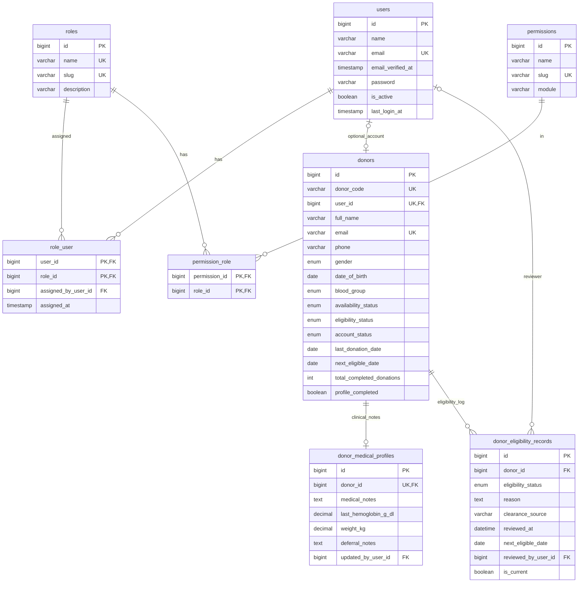
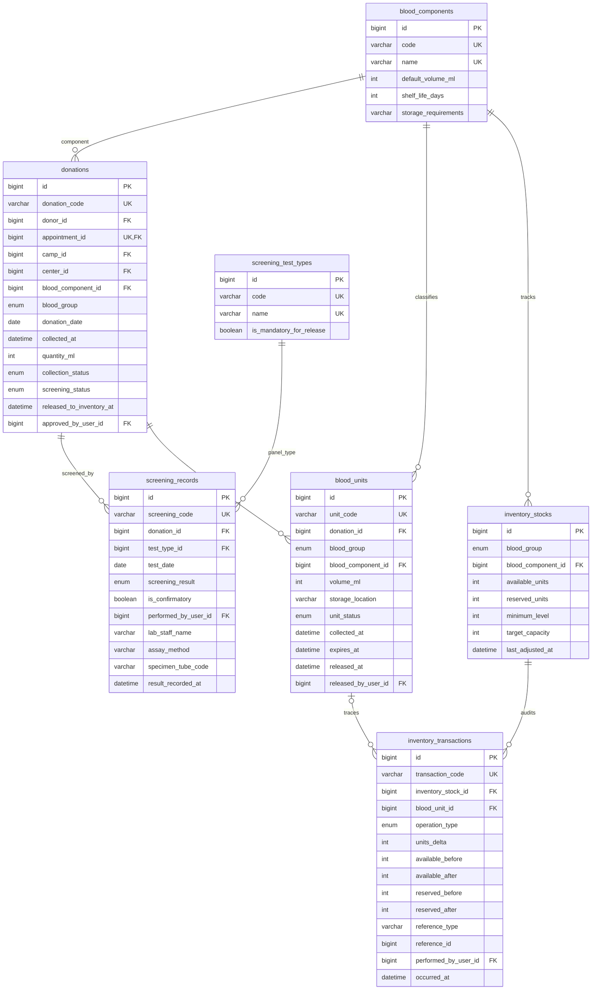
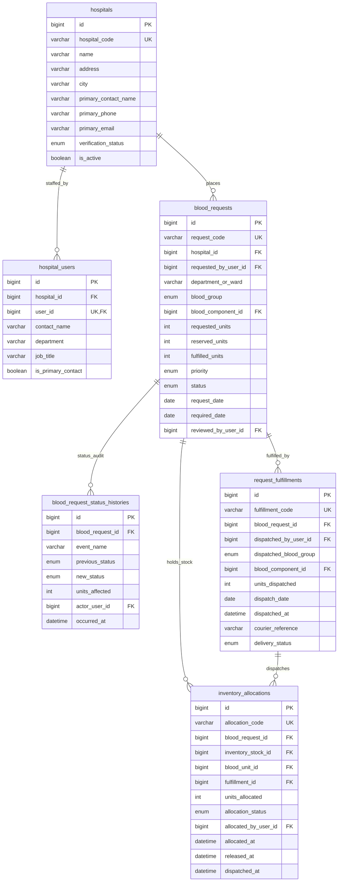
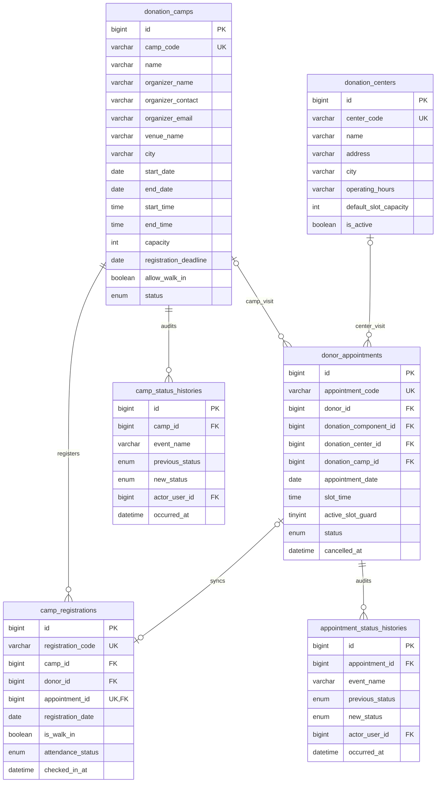

# BDMS Entity Relationship Diagram (ERD)

This document defines the complete relational data model for the **Blood Donation Management System (BDMS)**, derived directly from the existing application workflows, sample datasets, form schemas, and client-side business rules across all eight frontend modules.

> **Target Engine:** Laravel 13 (`database/migrations`) + MySQL 8.0+ (`utf8mb4` / `utf8mb4_unicode_ci`, InnoDB)  
> **Scope:** Design only (no migrations or Eloquent models modified in this phase)

---

## 1. Complete System ERD

```mermaid
erDiagram
    users ||--o{ role_user : "assigned"
    roles ||--o{ role_user : "granted_to"
    roles ||--o{ permission_role : "includes"
    permissions ||--o{ permission_role : "assigned_to"
    users ||--o{ password_reset_tokens : "resets_password"
    users ||--o{ sessions : "holds"

    users |o--o| donors : "authenticates_optional"
    donors ||--o| donor_medical_profiles : "protects_1_to_1"
    donors ||--o{ donor_eligibility_records : "audited_by"
    users |o--o{ donor_eligibility_records : "reviewed_by"

    users ||--o{ hospital_users : "acts_for"
    hospitals ||--o{ hospital_users : "employs"
    hospitals ||--o{ blood_requests : "submits"
    blood_components ||--o{ blood_requests : "specifies"

    blood_requests ||--o{ blood_request_status_histories : "logs_transitions"
    blood_requests ||--o{ inventory_allocations : "reserves_or_allocates"
    blood_requests ||--o{ request_fulfillments : "fulfilled_by"
    request_fulfillments ||--o{ inventory_allocations : "dispatches"

    blood_components ||--o{ inventory_stocks : "categorizes"
    inventory_stocks ||--o{ inventory_allocations : "sourced_from"
    inventory_stocks ||--o{ inventory_transactions : "ledger_for"

    donors ||--o{ donations : "donates"
    donor_appointments |o--o| donations : "results_in_optional"
    donation_camps |o--o{ donations : "hosts_optional"
    donation_centers |o--o{ donations : "hosts_optional"
    blood_components ||--o{ donations : "yields_type"

    donations ||--o{ screening_records : "tested_by"
    screening_test_types ||--o{ screening_records : "defines_panel"
    donations ||--o{ blood_units : "produces"
    blood_components ||--o{ blood_units : "classifies"
    blood_units |o--o{ inventory_allocations : "allocated_to_unit"
    blood_units |o--o{ inventory_transactions : "traced_by_unit"

    donors ||--o{ donor_appointments : "books"
    blood_components ||--o{ donor_appointments : "scheduled_type"
    donation_centers |o--o{ donor_appointments : "at_center_xor"
    donation_camps |o--o{ donor_appointments : "at_camp_xor"
    donor_appointments ||--o{ appointment_status_histories : "logs_changes"

    donation_camps ||--o{ camp_registrations : "registers"
    donors ||--o{ camp_registrations : "participates"
    donor_appointments |o--o| camp_registrations : "linked_from_portal"
    donation_camps ||--o{ camp_status_histories : "logs_changes"

    users |o--o{ donations : "records_or_approves"
    users |o--o{ screening_records : "performs"
    users |o--o{ blood_units : "releases"
    users |o--o{ inventory_transactions : "executes"
    users |o--o{ blood_requests : "submits_or_reviews"
    users |o--o{ request_fulfillments : "dispatches"
    users |o--o{ inventory_allocations : "allocates"
    users |o--o{ donation_camps : "creates"
    users |o--o{ camp_registrations : "logs"
```

---

## 2. Domain-Focused ER Views

To keep foreign keys and attributes readable during schema review, the complete model is broken into four domain views below.

### 2.1 Identity, RBAC, Donors & Clinical Governance

### 2.2 Donations, Laboratory Screening & Blood Inventory Traceability

### 2.3 Hospitals, Blood Requests, Reservations & Fulfillments

### 2.4 Donation Centers, Camps, Registrations & Donor Appointments

---

## 3. Relationship & Referential Integrity Matrix

| Relationship | Cardinality | Foreign Key Placement | Participation (Parent -> Child) | `ON DELETE` | `ON UPDATE` | Rationale |
|---|---|---|---|---|---|---|
| `users` → `role_user` ← `roles` | M:N | `role_user.user_id`, `role_user.role_id` | Optional → Mandatory | `CASCADE` (user_id) / `RESTRICT` (role_id) | `CASCADE` | Removing an unused user removes their role assignment; active roles cannot be dropped silently. |
| `roles` → `permission_role` ← `permissions` | M:N | `permission_role.role_id`, `permission_role.permission_id` | Optional → Mandatory | `CASCADE` | `CASCADE` | Standard permission-mapping pivot; clean role/permission maintenance. |
| `users` → `donors` | 1:0..1 | `donors.user_id` (`UNIQUE`) | Optional → Optional | `SET NULL` | `CASCADE` | Staff-registered walk-in donors may have no login account; if portal user is retired/unlinked, medical/donation donor history stays intact. |
| `donors` → `donor_medical_profiles` | 1:0..1 | `donor_medical_profiles.donor_id` (`UNIQUE`) | Mandatory → Optional | `RESTRICT` | `CASCADE` | Protects clinical deferral notes separately from directory queries; prevents accidental clinical wipe. |
| `donors` → `donor_eligibility_records` | 1:N | `donor_eligibility_records.donor_id` | Mandatory → Mandatory | `RESTRICT` | `CASCADE` | Longitudinal audit trail of staff clearance & deferral decisions (`DonorPortalController` model). |
| `donors` → `donations` | 1:N | `donations.donor_id` | Mandatory → Optional | `RESTRICT` | `CASCADE` | Donors who have given blood cannot be physically deleted; use `account_status = 'Inactive'`. |
| `donor_appointments` → `donations` | 1:0..1 | `donations.appointment_id` (`UNIQUE`) | Optional → Optional | `SET NULL` | `CASCADE` | Links completed scheduled visits (e.g., `APT-2012` → `DON-4310`), while walk-ins have `NULL`. |
| `donation_camps` → `donations` | 1:N | `donations.camp_id` | Optional → Optional | `RESTRICT` | `CASCADE` | Tracks collections performed at mobile drives; prevents deleting a camp with completed collections. |
| `donation_centers` → `donations` | 1:N | `donations.center_id` | Optional → Optional | `RESTRICT` | `CASCADE` | Tracks collections at permanent centers (`CTR-CENTRAL`, `CTR-WEST`, `CTR-SOUTH`). |
| `donations` → `screening_records` | 1:N | `screening_records.donation_id` | Mandatory → Optional | `RESTRICT` | `CASCADE` | One donation receives multiple test panels (`SCR-7105` HIV & `SCR-7104` Hepatitis B on `DON-4405`). Preserves lab audit history. |
| `screening_test_types` → `screening_records` | 1:N | `screening_records.test_type_id` | Mandatory → Mandatory | `RESTRICT` | `CASCADE` | Ensures all screening panels map to controlled serology/compatibility test types. |
| `donations` → `blood_units` | 1:N | `blood_units.donation_id` | Mandatory → Optional | `RESTRICT` | `CASCADE` | Guarantees zero inventory units exist without traceable donation provenance (`Available` only after passed screening). |
| `blood_components` → `inventory_stocks` | 1:N | `inventory_stocks.blood_component_id` | Mandatory → Mandatory | `RESTRICT` | `CASCADE` | Enables tracking stock by `(blood_group, blood_component_id)` with exact thresholds (`minimum_level`, `target_capacity`). |
| `inventory_stocks` → `inventory_transactions` | 1:N | `inventory_transactions.inventory_stock_id` | Mandatory → Mandatory | `RESTRICT` | `CASCADE` | Immutable stock movement ledger (`Added`, `Reserved`, `Dispatch`, `Removed`, `Expired`, `Discarded`). |
| `blood_units` → `inventory_transactions` | 1:N | `inventory_transactions.blood_unit_id` | Optional → Optional | `RESTRICT` | `CASCADE` | Traces individual bag transitions when unit-level movements occur; `NULL` allowed only for legacy/opening balance reconciliation. |
| `hospitals` → `hospital_users` ← `users` | 1:N / 1:1 | `hospital_users.hospital_id`, `hospital_users.user_id` (`UNIQUE`) | Mandatory → Mandatory | `RESTRICT` (hospital) / `CASCADE` (user) | `CASCADE` | Separates hospital facilities (`HSP-2049`) from authorized requester accounts. |
| `hospitals` → `blood_requests` | 1:N | `blood_requests.hospital_id` | Mandatory → Mandatory | `RESTRICT` | `CASCADE` | Normalizes hospital name/address/contact off repeated request rows and preserves requester audit history. |
| `blood_requests` → `blood_request_status_histories` | 1:N | `blood_request_status_histories.blood_request_id` | Mandatory → Mandatory | `RESTRICT` | `CASCADE` | Immutable timeline of request submission, approval, partial dispatch, completion, rejection, and cancellation. |
| `blood_requests` → `inventory_allocations` | 1:N | `inventory_allocations.blood_request_id` | Mandatory → Mandatory | `RESTRICT` | `CASCADE` | Tracks unit-level holds (`Reserved`) and dispatches (`Dispatched`) against a hospital request; reconciles reserved stock. |
| `inventory_stocks` → `inventory_allocations` | 1:N | `inventory_allocations.inventory_stock_id` | Mandatory → Mandatory | `RESTRICT` | `CASCADE` | Links every reservation/dispatch directly to its source inventory bucket. |
| `blood_units` → `inventory_allocations` | 1:N | `inventory_allocations.blood_unit_id` | Optional → Mandatory | `RESTRICT` | `CASCADE` | Enables unit-level crossmatch reservation (`Available → Reserved → Dispatched`), while released allocations keep historical trail. |
| `blood_requests` → `request_fulfillments` | 1:N | `request_fulfillments.blood_request_id` | Mandatory → Mandatory | `RESTRICT` | `CASCADE` | Supports multiple partial dispatches (`Partially Fulfilled` → `Fulfilled`) with courier tracking (`#TR-208`). |
| `request_fulfillments` → `inventory_allocations` | 1:N | `inventory_allocations.fulfillment_id` | Optional → Optional | `RESTRICT` | `CASCADE` | Connects physical dispatch batches directly to the specific allocated/reserved blood units sent on that courier run. |
| `donation_camps` → `camp_registrations` | 1:N | `camp_registrations.camp_id` | Mandatory → Mandatory | `RESTRICT` | `CASCADE` | Enforces active headcount vs capacity (`Registered`/`Confirmed`/`Attended`/`No-show` count; `Cancelled` excluded). |
| `donors` → `camp_registrations` | 1:N | `camp_registrations.donor_id` | Mandatory → Mandatory | `RESTRICT` | `CASCADE` | Paired with `UNIQUE (camp_id, donor_id)` to prevent duplicate camp registration. |
| `donation_camps` → `camp_status_histories` | 1:N | `camp_status_histories.camp_id` | Mandatory → Mandatory | `RESTRICT` | `CASCADE` | Audits camp creation, publishing, opening, completion, and cancellation events. |
| `donors` → `donor_appointments` | 1:N | `donor_appointments.donor_id` | Mandatory → Mandatory | `RESTRICT` | `CASCADE` | Paired with `active_slot_guard` unique constraint to stop double booking by the same donor at the same date & time. |
| `donation_centers` → `donor_appointments` | 1:N | `donor_appointments.donation_center_id` | Optional → Optional | `RESTRICT` | `CASCADE` | Fixed-center appointments (`CTR-WEST`, `CTR-SOUTH`), mutually exclusive with `donation_camp_id`. |
| `donation_camps` → `donor_appointments` | 1:N | `donor_appointments.donation_camp_id` | Optional → Optional | `RESTRICT` | `CASCADE` | Camp appointments (`CMP-308`), mutually exclusive with `donation_center_id`. |
| `donor_appointments` → `camp_registrations` | 1:0..1 | `camp_registrations.appointment_id` (`UNIQUE`) | Optional → Optional | `SET NULL` | `CASCADE` | Synchronizes Donor Portal camp bookings (`APT-2041` ↔ `REG-801`) with camp rosters. |
| `donor_appointments` → `appointment_status_histories` | 1:N | `appointment_status_histories.appointment_id` | Mandatory → Mandatory | `RESTRICT` | `CASCADE` | Audits Pending → Confirmed → Completed/Cancelled transitions. |

---

## 4. End-to-End Workflow Connection

1. **Public & Donor Entry**: Visitors register (`users`) and obtain the `donor` role (`role_user`) plus a `donors` row (`user_id`), or staff create `donors` directly for walk-ins (`user_id = NULL`). Sensitive notes live strictly in `donor_medical_profiles`, while clinical readiness sits in `donor_eligibility_records`.
2. **Scheduling**: Eligible or pending donors book `donor_appointments` at either a `donation_centers` clinic or an open `donation_camps` drive. Camp bookings automatically synchronize with `camp_registrations`.
3. **Collection & Screening**: Completed visits or walk-ins create a `donations` row (`DON-xxxx`). Lab technicians log panel tests in `screening_records` (`SCR-xxxx`) per `screening_test_types`. Until all required panels are `Passed` and verified (`released_to_inventory_at`), no usable stock enters circulation.
4. **Unit Release & Inventory Ledger**: Approved donations generate `blood_units` (`Available`) with expiration dates (`expires_at`), atomically increment `inventory_stocks.available_units`, and write an immutable `'Stock In'` entry to `inventory_transactions`.
5. **Hospital Request & Atomic Fulfillment**: Verified `hospitals` submit `blood_requests` (`REQ-xxxx`). Staff approve and reserve FIFO `blood_units` via `inventory_allocations` (`Reserved`), moving units from `available_units` to `reserved_units`. Each dispatch creates a `request_fulfillments` batch (`FUL-xxxx`), moves allocations & units to `Dispatched`, writes an `'Dispatch'` entry to `inventory_transactions`, increments `blood_requests.fulfilled_units`, and updates request status (`Partially Fulfilled` or `Fulfilled`).

