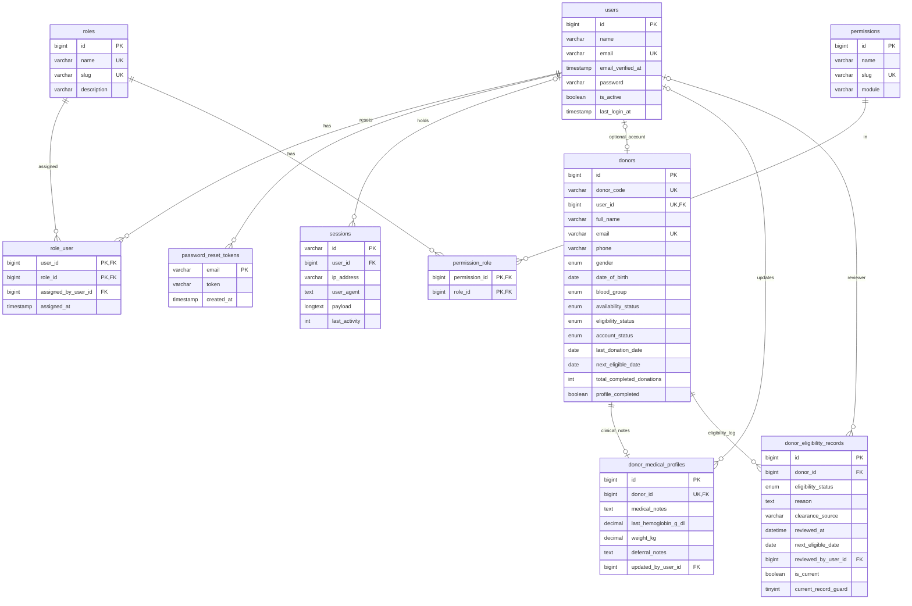
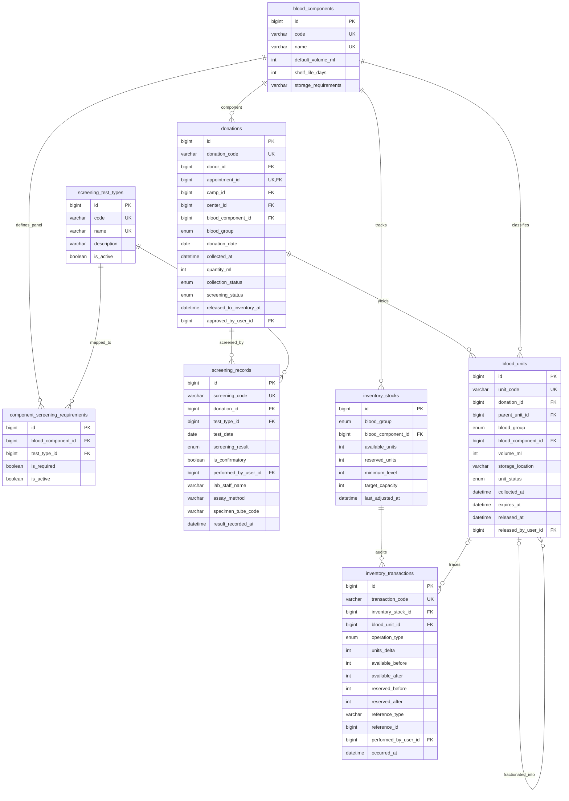
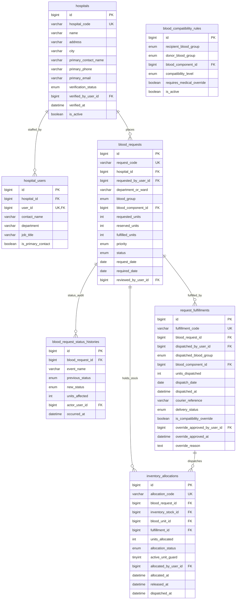
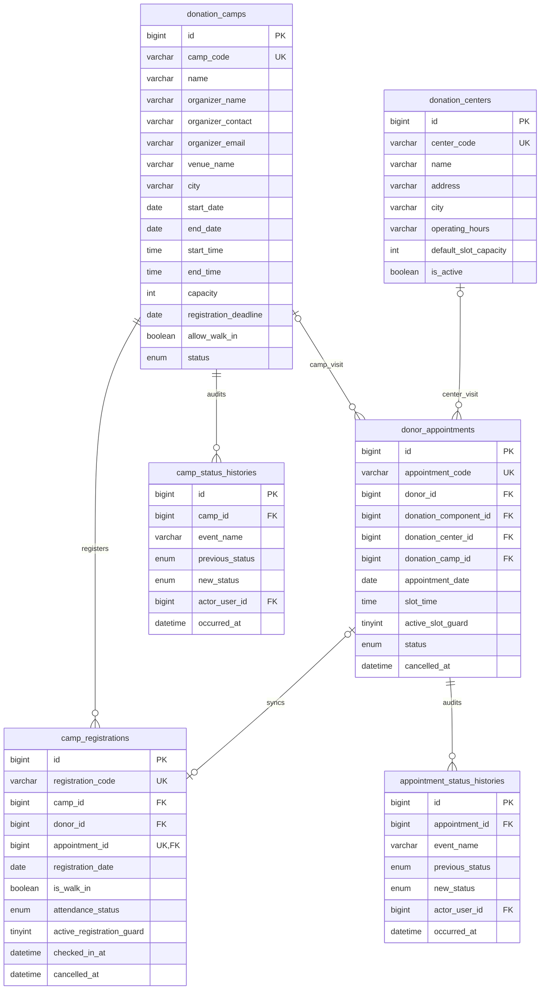

# BDMS Entity Relationship Diagram (ERD)

This document defines the final reviewed relational data model (**31 tables**: 3 Laravel baseline auth/session tables + 28 BDMS domain tables) for the **Blood Donation Management System (BDMS)**. It incorporates all resolved architectural, clinical-governance, inventory-traceability, and MySQL 8.4.3 / SQLite `:memory:` compatibility decisions.

> **Target Engine:** Laravel 13 (`database/migrations`) + MySQL 8.4.3 (`utf8mb4` / `utf8mb4_unicode_ci`, InnoDB) & SQLite `:memory:` (`phpunit.xml` test compatibility)  
> **Scope:** Design only (no migrations, models, controllers, or frontend files created/modified)

---

## 1. Complete System ERD

```mermaid
erDiagram
    users ||--o{ role_user : "assigned"
    roles ||--o{ role_user : "granted_to"
    roles ||--o{ permission_role : "includes"
    permissions ||--o{ permission_role : "assigned_to"
    users ||--o{ password_reset_tokens : "resets_password"
    users |o--o{ sessions : "holds"

    users |o--o| donors : "authenticates_optional"
    donors ||--o| donor_medical_profiles : "protects_1_to_1"
    users |o--o{ donor_medical_profiles : "updates"
    donors ||--o{ donor_eligibility_records : "audited_by"
    users |o--o{ donor_eligibility_records : "reviewed_by"

    users ||--o{ hospital_users : "acts_for"
    hospitals ||--o{ hospital_users : "employs"
    hospitals ||--o{ blood_requests : "submits"
    blood_components ||--o{ blood_requests : "specifies_optional"
    blood_components ||--o{ blood_compatibility_rules : "governs_component"

    blood_requests ||--o{ blood_request_status_histories : "logs_transitions"
    blood_requests ||--o{ inventory_allocations : "reserves_or_allocates"
    blood_requests ||--o{ request_fulfillments : "fulfilled_by"
    blood_components ||--o{ request_fulfillments : "dispatched_component"
    request_fulfillments ||--o{ inventory_allocations : "dispatches"

    blood_components ||--o{ inventory_stocks : "categorizes"
    inventory_stocks ||--o{ inventory_allocations : "sourced_from"
    inventory_stocks ||--o{ inventory_transactions : "ledger_for"

    donors ||--o{ donations : "donates"
    donor_appointments |o--o| donations : "results_in_optional"
    donation_camps |o--o{ donations : "hosts_optional"
    donation_centers |o--o{ donations : "hosts_optional"
    blood_components ||--o{ donations : "yields_type"

    blood_components ||--o{ component_screening_requirements : "configures_panels"
    screening_test_types ||--o{ component_screening_requirements : "required_by"
    donations ||--o{ screening_records : "tested_by"
    screening_test_types ||--o{ screening_records : "defines_panel"

    donations ||--o{ blood_units : "produces"
    blood_units |o--o{ blood_units : "derived_from_optional"
    blood_components ||--o{ blood_units : "classifies"
    blood_units |o--o{ inventory_allocations : "allocated_to_unit"
    blood_units |o--o{ inventory_transactions : "traced_by_unit"

    donors ||--o{ donor_appointments : "books"
    blood_components ||--o{ donor_appointments : "scheduled_type"
    donation_centers |o--o{ donor_appointments : "at_center_xor"
    donation_camps |o--o{ donor_appointments : "at_camp_xor"
    donor_appointments ||--o{ appointment_status_histories : "logs_changes"

    donation_camps ||--o{ camp_registrations : "registers"
    donors ||--o{ camp_registrations : "participates"
    donor_appointments |o--o| camp_registrations : "linked_from_portal"
    donation_camps ||--o{ camp_status_histories : "logs_changes"

    users |o--o{ hospitals : "verifies"
    users |o--o{ donations : "records_or_approves"
    users |o--o{ screening_records : "performs"
    users |o--o{ blood_units : "releases"
    users |o--o{ inventory_transactions : "executes"
    users |o--o{ blood_requests : "submits_or_reviews"
    users |o--o{ blood_request_status_histories : "actors_on"
    users |o--o{ request_fulfillments : "dispatches_or_overrides"
    users |o--o{ inventory_allocations : "allocates"
    users |o--o{ donation_camps : "creates"
    users |o--o{ camp_registrations : "logs"
    users |o--o{ camp_status_histories : "actors_on"
    users |o--o{ appointment_status_histories : "actors_on"
```

---

## 2. Domain-Focused ER Views

### 2.1 Identity, Sessions, RBAC, Donors & Clinical Governance

### 2.2 Donations, Component Screening Matrix, Units & Inventory Ledger

### 2.3 Hospitals, Compatibility Rules, Requests & Fulfillment

### 2.4 Donation Centers, Camps, Registrations & Donor Appointments

---

## 3. Relationship & Referential Integrity Matrix

| Relationship | Cardinality | Foreign Key Placement | Participation (Parent -> Child) | `ON DELETE` | `ON UPDATE` | Rationale |
|---|---|---|---|---|---|---|
| `users` → `role_user` ← `roles` | M:N | `role_user.user_id`, `role_user.role_id` | Optional → Mandatory | `CASCADE` (`user_id`) / `RESTRICT` (`role_id`) | `CASCADE` | Removing an unused user deletes role assignments; active roles cannot be dropped silently. |
| `roles` → `permission_role` ← `permissions` | M:N | `permission_role.role_id`, `permission_role.permission_id` | Optional → Mandatory | `CASCADE` | `CASCADE` | Standard permission-mapping pivot. |
| `users` → `password_reset_tokens` / `sessions` | 1:N | `password_reset_tokens.email` (PK) / `sessions.user_id` | Optional → Optional | Application / Session GC | — | Existing Laravel 13 auth & session tables. |
| `users` → `donors` | 1:0..1 | `donors.user_id` (`UNIQUE`) | Optional → Optional | `SET NULL` | `CASCADE` | Walk-in donors may lack logins; unlinking a login keeps clinical donor history intact. |
| `donors` → `donor_medical_profiles` | 1:0..1 | `donor_medical_profiles.donor_id` (`UNIQUE`) | Mandatory → Optional | `RESTRICT` | `CASCADE` | Isolates confidential clinical notes from public/portal queries. |
| `donors` → `donor_eligibility_records` | 1:N | `donor_eligibility_records.donor_id` | Mandatory → Mandatory | `RESTRICT` | `CASCADE` | Authoritative eligibility source of truth (`UNIQUE (donor_id, current_record_guard)` enforces one active row; `donors.eligibility_status` is a read-only synced cache). |
| `donors` → `donations` | 1:N | `donations.donor_id` | Mandatory → Optional | `RESTRICT` | `CASCADE` | Preserves immutable donation provenance; donors deactivate via `account_status`. |
| `donor_appointments` → `donations` | 1:0..1 | `donations.appointment_id` (`UNIQUE`) | Optional → Optional | `SET NULL` | `CASCADE` | Connects completed visits (e.g., `APT-2012` → `DON-4310`); walk-ins leave `NULL`. |
| `donation_camps` / `donation_centers` → `donations` | 1:N | `donations.camp_id`, `donations.center_id` | Optional → Optional | `RESTRICT` | `CASCADE` | Traces collection facilities without blocking ad-hoc legacy location labels. |
| `blood_components` → `component_screening_requirements` ← `screening_test_types` | M:N | `blood_component_id`, `test_type_id` | Mandatory → Optional | `RESTRICT` | `CASCADE` | Seeded mandatory for all 5 current assays (`HIV`, `HBV`, `HCV`, `Syphilis`, `Compatibility`) across all components; extensible for future policies. |
| `donations` → `screening_records` | 1:N | `screening_records.donation_id` | Mandatory → Optional | `RESTRICT` | `CASCADE` | One donation carries multiple assay panels (`HIV`, `HBV`, `HCV`, `Syphilis`, `Compatibility`). |
| `screening_test_types` → `screening_records` | 1:N | `screening_records.test_type_id` | Mandatory → Mandatory | `RESTRICT` | `CASCADE` | Controlled panel taxonomy. |
| `donations` → `blood_units` | 1:N | `blood_units.donation_id` | Mandatory → Optional | `RESTRICT` | `CASCADE` | Supports both 1-donation-to-1-unit and future multi-component fractionation (`parent_unit_id`). |
| `blood_units` → `blood_units` (Self) | 1:N | `blood_units.parent_unit_id` | Optional → Optional | `SET NULL` | `CASCADE` | Traces derived component bags back to parent Whole Blood draw bag. |
| `blood_components` → `inventory_stocks` | 1:N | `inventory_stocks.blood_component_id` | Mandatory → Mandatory | `RESTRICT` | `CASCADE` | Tracks `(blood_group, blood_component_id)` stock while aggregating clean 8-group totals. |
| `inventory_stocks` → `inventory_transactions` | 1:N | `inventory_transactions.inventory_stock_id` | Mandatory → Mandatory | `RESTRICT` | `CASCADE` | Immutable audit ledger for every stock change. |
| `blood_units` → `inventory_transactions` | 1:N | `inventory_transactions.blood_unit_id` | Optional → Optional | `RESTRICT` | `CASCADE` | Bag-level traceability inside movement ledger. |
| `blood_components` → `blood_compatibility_rules` | 1:N | `blood_compatibility_rules.blood_component_id` | Mandatory → Optional | `RESTRICT` | `CASCADE` | Component-specific substitution matrix (`RBC` vs `Plasma` differ clinically). |
| `hospitals` → `hospital_users` ← `users` | 1:N / 1:1 | `hospital_users.hospital_id`, `hospital_users.user_id` (`UNIQUE`) | Mandatory → Mandatory | `RESTRICT` (`hospital`) / `CASCADE` (`user`) | `CASCADE` | Separates hospital facilities (`HSP-2049`) and verification gates from user credentials. |
| `hospitals` → `blood_requests` | 1:N | `blood_requests.hospital_id` | Mandatory → Mandatory | `RESTRICT` | `CASCADE` | Normalized requester ownership; blocks unverified facilities in backend service/policy. |
| `blood_requests` → `blood_request_status_histories` | 1:N | `blood_request_status_histories.blood_request_id` | Mandatory → Mandatory | `RESTRICT` | `CASCADE` | Complete request audit history. |
| `blood_requests` → `inventory_allocations` | 1:N | `inventory_allocations.blood_request_id` | Mandatory → Mandatory | `RESTRICT` | `CASCADE` | Explicit unit reservations vs dispatches via `active_unit_guard`. |
| `inventory_stocks` / `blood_units` → `inventory_allocations` | 1:N | `inventory_stock_id`, `blood_unit_id` | Mandatory → Optional | `RESTRICT` | `CASCADE` | Links reserved/dispatched bags cleanly; prevents concurrent multi-request allocation. |
| `blood_requests` → `request_fulfillments` | 1:N | `request_fulfillments.blood_request_id` | Mandatory → Mandatory | `RESTRICT` | `CASCADE` | Supports multiple partial dispatches (`Partially Fulfilled` → `Fulfilled`) and medical override tracking. |
| `request_fulfillments` → `inventory_allocations` | 1:N | `inventory_allocations.fulfillment_id` | Optional → Optional | `RESTRICT` | `CASCADE` | Connects physical courier batch to specific dispatched `blood_units`. |
| `donation_camps` → `camp_registrations` ← `donors` | 1:N / 1:N | `camp_id`, `donor_id` | Mandatory → Optional | `RESTRICT` | `CASCADE` | Guarded by `UNIQUE (camp_id, donor_id, active_registration_guard)` so `'Cancelled'` rows stay archived while re-registration works. |
| `donation_camps` → `camp_status_histories` | 1:N | `camp_status_histories.camp_id` | Mandatory → Mandatory | `RESTRICT` | `CASCADE` | Camp status & roster audit events. |
| `donors` / `donation_centers` / `donation_camps` → `donor_appointments` | 1:N | `donor_id`, `donation_center_id`, `donation_camp_id` | Mandatory/Optional → Optional | `RESTRICT` | `CASCADE` | Booking requires `donors.profile_completed = 1`; guarded by XOR location check + `UNIQUE (donor_id, appointment_date, slot_time, active_slot_guard)`. |
| `donor_appointments` → `camp_registrations` | 1:0..1 | `camp_registrations.appointment_id` (`UNIQUE`) | Optional → Optional | `SET NULL` | `CASCADE` | Syncs Donor Portal camp bookings (`APT-2041` ↔ `REG-801`). |
| `donor_appointments` → `appointment_status_histories` | 1:N | `appointment_status_histories.appointment_id` | Mandatory → Mandatory | `RESTRICT` | `CASCADE` | Booking status audit trail. |
